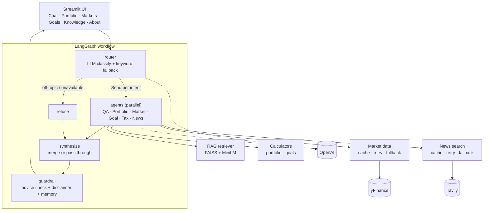

# Finnie: AI Finance Assistant

A multi-agent conversational tutor that helps beginners learn investing. Six specialist agents sit behind one chat box; a LangGraph router sends each question to the right agent(s), answers are grounded in a 103-article knowledge base (RAG) or live data, and a guardrail keeps everything on the **education, not advice** side of the line.

> **Disclaimer.** Finnie is an educational project. Nothing it says is financial, tax or investment advice. The knowledge-base articles are AI-drafted and not yet human-reviewed (`reviewed: false` in their front-matter); verify anything important with the cited reference sites or a licensed professional.

## Features

| Capability | How it works |
|---|---|
| **Six agents** | Finance Q&A · Portfolio Analysis · Market Analysis · Goal Planning · News Synthesizer · Tax Education |
| **Smart routing** | LLM intent classifier (structured JSON) with keyword fallback; multi-part questions fan out to several agents in parallel and are merged into one answer |
| **RAG with citations** | 103 articles → 702 chunks → FAISS + `all-MiniLM-L6-v2`; answers cite `[1] [2]` and list sources; category filtering |
| **Live data** | yFinance quotes/history, Tavily news; 30-min cache, retry with backoff, stale and sample fallbacks, always labelled (Live / Cached / Delayed / Sample) |
| **Deterministic maths** | Portfolio metrics and goal projections are computed in code; the LLM only explains the numbers |
| **Guardrail** | "Should I buy X?" is reframed as education; generated recommendations are rewritten; one disclaimer guaranteed |
| **Memory** | Per-conversation history and a user profile (risk tolerance, knowledge level) via LangGraph checkpointer |
| **Web UI** | Streamlit: Chat · Portfolio · Markets · Goals · Knowledge, plus an **About Finnie** menu (architecture, design, technologies) |
| **Private login** | Single owner, no sign-up. Salted scrypt password hash (no plaintext stored), lockout after 5 failed attempts, 8-hour sessions, sign-out button |
| **MCP server** | Six tools for Claude Desktop (quotes, trends, portfolio, goal plan, KB search, ask Finnie) |

## Architecture overview



Full detail, including agent communication, RAG internals and performance notes, is in [`docs/DESIGN.md`](docs/DESIGN.md). The same material is in the app under **About Finnie** (top-right menu).

## Quick start

Requirements: Python 3.12, an OpenAI API key. A Tavily key is optional (without it, News shows clearly-labelled sample items).

```bash
cd ai_finance_assistant
python3.12 -m venv .venv && source .venv/bin/activate
pip install -r requirements.txt
cp .env.example .env            # then add OPENAI_API_KEY (and optionally TAVILY_API_KEY)
python -m scripts.build_index   # one-off: builds the FAISS index from src/data/articles
streamlit run src/web_app/app.py
```

Open http://localhost:8501.

Other entry points:

```bash
python -m scripts.chat_cli                                              # terminal chat
python -m scripts.chat_cli --portfolio data_samples/sample_portfolio.csv --risk moderate "Analyze my portfolio"
python -m scripts.generate_articles --limit 5                           # draft more articles from src/data/topics.yaml
pytest --cov=src                                                        # run the tests
```

### Docker

```bash
docker compose up --build       # reads keys from .env; app on http://localhost:8501
```

The image bakes in the FAISS index and embedding model. Keys are never copied into the image. *(The Dockerfile was written for this project but has not been built in the development environment, which had no Docker; see Troubleshooting if the build fails.)*

### MCP server (Claude Desktop)

Add to Claude Desktop's config (`~/Library/Application Support/Claude/claude_desktop_config.json` on macOS), using your absolute paths:

```json
{
  "mcpServers": {
    "finnie": {
      "command": "/ABSOLUTE/PATH/ai_finance_assistant/.venv/bin/python",
      "args": ["-m", "src.mcp_server"],
      "env": { "PYTHONPATH": "/ABSOLUTE/PATH/ai_finance_assistant" }
    }
  }
}
```

Restart Claude Desktop. Tools: `get_stock_quote`, `get_price_trend`, `analyze_portfolio_csv`, `plan_savings_goal`, `search_knowledge_base`, `ask_finnie` (the last needs `OPENAI_API_KEY`).

## Private login (no sign-up)

The app is gated by a single owner account so a public deployment can't spend your OpenAI budget. There is no sign-up, no password reset and no user database. The email and a **salted scrypt hash** of the password are read from `AUTH_EMAIL` / `AUTH_PASSWORD_HASH`; the password itself is never stored. If either is missing or malformed the app **stays locked** (it never falls back to open access), and nothing else (model, services, data) starts until sign-in succeeds.

Set or change the credentials (the password is not echoed or saved):

```bash
python -m scripts.set_password --email you@example.com --write-env   # prompts for the password, updates .env
```

**Streamlit Cloud** (Community Cloud, free): don't upload `.env`. Secrets are set **per app**, not in your account settings: either in the *Advanced settings → Secrets* box when you first deploy, or later via the app's **⋮ → Settings → Secrets** (also reachable from *Manage app* inside the running app). Paste (TOML):

```toml
OPENAI_API_KEY = "..."
TAVILY_API_KEY = "..."
AUTH_EMAIL = "you@example.com"
AUTH_PASSWORD_HASH = "scrypt$16384$8$1$..."   # copy the value from your local .env
```

Protections: 5 failed attempts within 15 minutes lock all sign-ins for 15 minutes (global, so new browser sessions don't reset it); one generic error message for a wrong email or password; the password hash is computed even for an unknown email so timing doesn't reveal which was wrong; sessions expire after 8 hours. Use a **long passphrase**: if the hash ever leaks, a short or common password can be cracked offline despite scrypt.

Why no database? Streamlit Cloud's disk is wiped on reboot (a SQLite file would lose its data), and a credentials file committed to a public repo would be exposed. For one owner, a hash in Secrets is both simpler and safer.

## Usage examples

| Try this | Handled by |
|---|---|
| "What's the difference between an ETF and a mutual fund?" | Finance Q&A (RAG, cited) |
| "How is NVDA doing today?" | Market Analysis |
| "I want $60,000 in 8 years and have $5,000. How much should I save monthly?" then "what about 12 years?" | Goal Planning (follow-up uses memory) |
| "How are capital gains taxed on stocks I hold for over a year?" | Tax Education |
| "What's the latest news on interest rates?" | News Synthesizer |
| "Analyze my portfolio and explain diversification" | Portfolio Analysis + Q&A, merged |
| "Should I buy Tesla?" | Guardrail reframes it as education |

**Portfolio CSV format** (`symbol`, `shares`, optional `cost_basis` per share; `ticker`/`quantity`/`avg_cost` also accepted):

```csv
symbol,shares,cost_basis
AAPL,40,150
VOO,10,400
```

## Configuration

Non-secret settings live in `config.yaml`; secrets in `.env` (never committed).

| Setting | Default | Meaning |
|---|---|---|
| `llm.model` | `gpt-4o-mini` | OpenAI model for all agents |
| `market_data.cache_ttl_seconds` | 1800 | Quote/history cache lifetime |
| `market_data.use_mock_on_failure` | true | Fall back to sample prices (known tickers only) |
| `news.max_results` / `news.use_sample_on_failure` | 5 / true | News breadth and fallback |
| `rag.chunk_size` / `chunk_overlap` | 800 / 120 | Characters per chunk |
| `rag.top_k` / `min_score` | 4 / 0.25 | Passages retrieved and relevance cutoff |
| `router.confidence_threshold` | 0.6 | Below this, LLM intents are unioned with keyword matches |
| `router.agent_timeout_seconds` | 60 | Per-agent time limit |

## Project structure

```
ai_finance_assistant/
├── src/
│   ├── agents/       six agents (finance_qa, portfolio_analysis, market_analysis, goal_planning, tax_education, news_synthesizer)
│   ├── core/         BaseAgent, LLM interface, settings, portfolio + goal calculators
│   ├── data/         market data and news layers, asset reference table, article corpus, topics outline
│   ├── rag/          loader, chunker, embeddings, FAISS vector store, retriever
│   ├── workflow/     LangGraph graph, router, state, guardrail, factory (wiring)
│   ├── web_app/      Streamlit app, tabs, charts, About menu
│   ├── mcp_server/   MCP tools for Claude Desktop
│   └── utils/        logging, tolerant JSON parsing
├── scripts/          build_index, generate_articles, chat_cli
├── tests/            pytest suite (mocked LLM and APIs, headless UI tests)
├── docs/DESIGN.md    technical design document
├── config.yaml  requirements.txt  Dockerfile  docker-compose.yml  DEMO.md  PLAN.md
```

## API reference (main interfaces)

**Workflow**: `FinnieWorkflow.chat(query, thread_id="default", profile=None, context=None) -> ChatResult`
`context` may carry `portfolio` (list of `{symbol, shares, cost_basis}`) and `goal` (`{target, years, current, risk, monthly}`). `ChatResult` has `content`, `sources`, `agents`, `route`, `guardrail`, `responses`. Build one with `build_workflow()` or all services with `build_services()` (`src/workflow/factory.py`).

**Agents**: subclass `BaseAgent` and implement `async _handle(query, context) -> AgentResponse`; `run()` adds logging and error containment. Register new agents in `factory.py` and add the intent to the router.

**Data services**: `MarketDataService.get_quote / get_trend / get_quotes / clear_cache`; `NewsService.search`. Every result carries a `source` of `live | cache | stale | mock | sample`.

**RAG**: `VectorStore.build / search / save / load`; `Retriever.retrieve(query, category=None, strict=False)` (strict filter vs soft hint) and `retrieve_preferring`.

**Calculators** (pure functions): `analyze_portfolio(holdings, quotes)`, `parse_holdings_csv(text)`, `plan_goal(target, years, current, risk, monthly)`, `future_value`, `required_monthly`.

**MCP tools**: see the table above; each returns structured JSON and raises a tool error for bad input.

## Testing

```bash
pytest --cov=src --cov-report=term-missing
```

200 tests, ~98% line coverage. The LLM, yFinance, Tavily and embedding model are faked behind small interfaces, so tests run offline without keys. The UI is tested headlessly with Streamlit's `AppTest`; the MCP tools are tested in-process and the server was also exercised over real stdio. Live behaviour (real OpenAI, yFinance, Tavily) was verified manually, not by the automated suite.

## Troubleshooting

| Symptom | Fix |
|---|---|
| "Finnie couldn't start: No index in …" | Run `python -m scripts.build_index` |
| "OPENAI_API_KEY is not set" | Copy `.env.example` to `.env` and add the key |
| Prices show "Sample data" or "Delayed" | yFinance is rate-limiting or offline; wait, or press Refresh in the Markets tab. The app keeps working on cached/sample data |
| News shows "sample items" | No `TAVILY_API_KEY`, or the search failed |
| Unknown ticker error | Common tickers work as typed; write less common ones like `$PLTR` in chat |
| Slow first start | The embedding model loads once on startup (a few seconds) |
| `pip install` conflicts | Use Python 3.12 in a fresh venv |
| Docker build fails at `build_index` | It needs network access to download the embedding model; build on a connected machine |
| Streamlit Cloud | Needs the index at startup: un-ignore `src/data/index/` or run the build step on boot; use `st.secrets` for keys (supported) |

## Known limitations

- Knowledge-base articles are AI-drafted and **not yet human-reviewed**; sources point to reference sites' home pages, not deep links.
- Only OpenAI (LLM) and yFinance (prices) are implemented; Gemini and Alpha Vantage are not.
- Conversation memory is in-process: it resets when the app restarts.
- Login sessions live in the browser session: refreshing the page signs you out. The lockout counter is in memory and resets on restart. The CLI and MCP server are local tools and are not behind the login.
- US-centric tax and account content; English only.
- Goal return assumptions (low 2/4/6%, moderate 3/6/9%, high 4/8/11%) are illustrative, not forecasts.
- Streamlit Cloud and Docker deployment are untested here.
- No explicit prompt-injection defence for web text fed to the News agent (see `docs/DESIGN.md` §11).

## Roadmap

Human review of the corpus with deep-link citations; a persistent checkpointer (SQLite/Postgres); Gemini and Alpha Vantage providers; streaming responses; evaluation set for retrieval and routing quality; voice interface.
