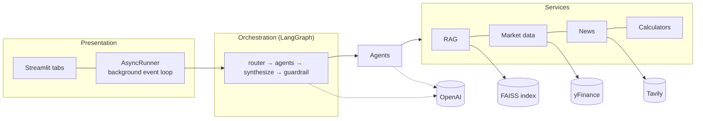

# Finnie: Technical Design Document

## 1. Goals and constraints

**Goal.** Teach beginners about investing through one conversational interface, with answers that are grounded, current where it matters, and clearly educational.

**Constraints that shaped the design**

- *Regulatory*: must not give personalised financial advice → guardrail node, disclaimers, prompts that forbid recommendations.
- *Accuracy*: numbers must be right → calculations are code, not LLM output.
- *Reliability*: free-tier APIs fail and rate-limit → caches, retries, labelled fallbacks.
- *Trust*: users should see where answers come from → citations and source lists, freshness labels.
- *Scope*: four weeks, one developer → small, well-tested modules over breadth.

## 2. System architecture



Module map: `src/agents` (six agents), `src/core` (BaseAgent, LLM interface, settings, calculators), `src/data` (market, news, asset table, corpus), `src/rag`, `src/workflow` (graph, router, guardrail, state, factory), `src/web_app`, `src/mcp_server`.

## 3. Architecture decisions

| # | Decision | Alternatives considered | Why |
|---|---|---|---|
| 1 | **LangGraph** for orchestration | CrewAI; hand-rolled asyncio | Explicit graph, parallel `Send` fan-out, built-in checkpointing, testable nodes |
| 2 | **Code computes, LLM explains** for portfolio and goals | Let the LLM calculate | Reproducible, unit-testable, no hallucinated numbers |
| 3 | **yFinance** primary market source | Alpha Vantage | No key, no 25-requests/day cap that breaks demos |
| 4 | **Local embeddings** (MiniLM) + **FAISS flat index** | Hosted embeddings; Chroma/Pinecone | No API cost or latency; ~700 chunks, so exact search is fast and makes filtering exact |
| 5 | **Router: LLM classifier + keyword fallback + union on low confidence** | Pure LLM; pure keywords | Handles multi-intent questions and survives LLM outages |
| 6 | **Router category is a soft hint** | Hard filter | Observed failure: guessed category "tax" hid the Roth IRA article (filed under "retirement") |
| 7 | **JSON-friendly graph state** | Dataclasses/objects in state | Any checkpointer can persist it; avoids deserialisation of arbitrary types |
| 8 | **Never fabricate data**: sample prices only for known tickers | Hash-generated mock prices | Showing a made-up price as data is worse than an error |
| 9 | **Single background event loop** for Streamlit | `asyncio.run` per call | Async clients stay bound to one loop; no "loop is closed" errors |
| 10 | **Guardrail as a graph node** after merging | Per-agent checks | One enforcement point, covers merged and single answers, and stores the guarded text as memory |

## 4. Agent communication protocol

**Contract.** Every agent extends `BaseAgent` and implements `async _handle(query, context) -> AgentResponse`.

```python
AgentResponse(agent, content, sources: list[Source], data: dict, error: str | None)
context = {profile, history[-6:], portfolio?, goal?, category?}   # read-only inputs
```

- `run()` wraps `_handle`: empty query short-circuit, logging, `LLMError` → friendly fallback (`error="llm_error: …"`), any other exception → fallback (`error="unexpected: …"`). Agents never crash the workflow.
- Agents do not call each other. All coordination is through the graph: the router selects, `Send` dispatches with a copy of state plus `intent`, and each agent node returns `{"responses": [dict]}`.
- `responses` has an **append reducer** so parallel branches don't overwrite each other. Each entry is tagged with the `turn` number, and the synthesizer reads only the current turn (state persists across turns via the checkpointer).
- Agent nodes run under `asyncio.wait_for(…, 60 s)`; a timeout becomes an error response.

**Routing algorithm**

1. Classifier prompt = last 4 messages + latest message → `{intents, confidence, category}` (JSON, parsed tolerantly).
2. Invalid output, exception, or 15 s timeout → keyword rules; nothing matches → `finance_qa`.
3. `confidence < 0.6` → `intents ∪ keyword intents`.
4. `off_topic` is dropped if other intents are present.
5. Intents resolve against registered agents; unavailable ones are recorded and, if nothing remains, the `refuse` node answers.

**Merging.** One good response is passed through unchanged. Several are merged by an LLM prompt that keeps numbers, citations and caveats and omits disclaimers (disclaimers are stripped from inputs and re-added once). If the merge call fails, the answers are concatenated under headings. If some agents failed, a note names what was skipped.

**Guardrail.** (a) Query matches advice-seeking patterns → prepend a framing note. (b) Answer matches recommendation patterns → LLM rewrite; if the rewrite still matches or is empty, drop the offending sentences. (c) Ensure exactly one disclaimer (not on off-topic/unavailable refusals). The guarded text is what gets stored as chat memory.

**Memory.** `MemorySaver` keyed by `thread_id`. `messages` is append-only; `profile` persists unless re-sent; `context` is replaced each turn (the UI re-sends the portfolio). Follow-ups work because the router and Goal agent receive recent user messages.

## 5. RAG implementation

**Corpus.** 103 Markdown articles in 12 categories, drafted from `src/data/topics.yaml` by `scripts/generate_articles.py`, each with front-matter (`title`, `category`, `source`, `source_url`, `reviewed`). The source is the reference publisher's site (Investopedia, SEC Investor.gov, Bogleheads, IRS); deep links are not invented. Articles are AI-drafted and flagged `reviewed: false` until a human checks them.

**Indexing.** Section-aware chunking (split on `##`, then windows of 800 characters with 120 overlap, breaking at whitespace) → 702 chunks. Embeddings: `all-MiniLM-L6-v2`, 384-d, L2-normalised. Index: FAISS `IndexFlatIP` (inner product = cosine). Persisted as `index.faiss` + `chunks.json`; load verifies they are in sync.

**Retrieval.** Embed the query; score all chunks; apply the category rule; cut at `min_score=0.25`; keep `top_k=4`.

- *Strict* category (Knowledge tab): filter hard.
- *Soft* category (router): use the category's hits only if the best one is within 0.05 of the best unfiltered hit.
- *Preferring* (Tax agent): +0.06 score bonus to `tax` and `retirement` chunks, then re-rank.

**Generation.** Passages are numbered `[1]…[n]` in the prompt; the model must answer only from them and cite inline; sources are de-duplicated by article. No passages above threshold → a labelled general answer, or a polite decline if the topic isn't finance. Observed live scores: 0.65–0.80 for on-topic questions.

## 6. External data layer

`MarketDataService` and `NewsService` share one pattern (tested for both):

`TTL cache (30 min)` → `provider with retry (exponential backoff 1 s, 2 s)` → `stale cache` → `fallback data` → `error`

Each result carries a `source` (`live | cache | stale | mock | sample`) shown in the UI. Fallback prices exist only for a fixed set of known tickers; others raise `MarketDataError`. yFinance is synchronous, so calls run in `asyncio.to_thread`. The clock and sleep functions are injectable, which keeps the tests fast and deterministic.

## 7. Deterministic calculators

- **Portfolio.** Value = Σ shares × price; weights; allocation by asset class and sector from a bundled reference table (~38 tickers with class, sector and approximate expense ratio); unknown symbols are classified "stock / Other" with a warning. Diversification = (1/HHI − 1)/9 × 100 clamped to [0, 100] (one holding = 0, ten or more equal holdings = 100). Risk rating is rule-based from equity, crypto and commodity share. Warnings: concentration over 30%, fewer than 5 holdings, no bonds, crypto over 10%, unknown symbols.
- **Goals.** Monthly-compounding future value `FV = P(1+r)^n + C((1+r)^n − 1)/r` and its inverse for required monthly saving. Three annual-return scenarios per risk profile (low 2/4/6%, moderate 3/6/9%, high 4/8/11%). Inputs are validated (target > 0, 0 < years ≤ 80, no negatives).

## 8. UI architecture

Streamlit reruns the script on every interaction, so heavy objects (workflow, services, model) live in `st.cache_resource`. A background thread runs one event loop; tabs call `Runtime.run(coro)`. Session state holds the thread id, chat log, profile, holdings, last analysis and plan. Charts are pure functions (`charts.py`) returning Plotly figures with a validated colour palette (fixed categorical slot order, ink-coloured labels, one axis per chart). Every data display shows its freshness label. The About Finnie menu sits at the top right beside Streamlit's toolbar (fixed-position CSS, refined by a small script that measures the toolbar). Choosing an item opens a modal; because `st.popover` cannot be closed from code, the popover key includes a counter that is bumped on selection so the menu re-renders closed. Diagrams are rendered by Graphviz.

## 9. Error handling summary

| Failure | Behaviour |
|---|---|
| LLM error / timeout in an agent | Friendly fallback for that agent; others still answer |
| Classifier failure | Keyword routing |
| Merge failure | Concatenate answers under headings |
| yFinance / Tavily failure | Retry → stale → labelled sample → error for unknown symbols |
| Missing index / API key | Clear startup message with the fix |
| Bad portfolio / goal input | Specific validation message, no crash |
| Malformed LLM JSON | Tolerant parser; missing goal fields → the agent asks for them |

## 10. Performance considerations

- Parallel fan-out: multi-intent latency is the slowest agent, not the sum.
- Local embeddings and a flat index: retrieval is milliseconds for ~700 chunks; the LLM call dominates latency.
- 30-minute caches protect free-tier limits and make repeat views instant.
- Embedding model and index load once per process; the Docker image bakes them in for fast starts.
- Blocking libraries run in worker threads so the event loop is never blocked.
- Scaling limits: flat search is O(chunks), fine to roughly 10⁵ chunks; in-memory checkpointer and caches are per-process (use a shared store and Redis/DB for multi-instance deployment).

## 11. Security and privacy

**Access control.** The UI is gated by a single-owner login before any service starts (see README, *Private login*). `src/core/auth.py` holds the pure logic: `hashlib.scrypt` (N=2^14, r=8, p=1, 16-byte random salt, self-describing `scrypt$N$r$p$salt$hash` format), constant-time comparison, a process-wide lockout (5 failures in 15 min → 15 min lock), and 8-hour session expiry. Missing or malformed credentials fail closed. There is no sign-up or reset flow by design. Residual risks: the lockout and sessions are in memory (reset on restart/refresh), the hash is only as strong as the password chosen, and the CLI/MCP entry points are local and ungated.

API keys live in `.env` (git-ignored, excluded from Docker context) or `st.secrets`. User portfolios are held in session memory only and sent to the LLM as aggregated metrics, not raw account data. No authentication (single-user, session-scoped). **Known gap:** the News agent passes third-party web text to the LLM, and no prompt or filter explicitly defends against instructions hidden in that text (prompt injection). The blast radius is limited (agents have no tools that act on the world, the guardrail rewrites recommendation language, and answers are text only), but a production deployment should add content sanitisation and an injection-resistant prompt design.

## 12. Testing strategy

Unit tests for each module; the LLM, yFinance, Tavily and embeddings are faked behind small interfaces. Workflow tests cover routing, fan-out, merge, timeouts, partial failure, memory isolation and the guardrail. Headless UI tests (Streamlit `AppTest`) drive every tab and the About menu. MCP tools are tested in-process and the server was verified over real stdio. Live behaviour was verified manually against real services. 200 tests, ~98% line coverage. Not covered by automation: real network behaviour, visual layout, Docker build.

## 13. Limitations and future work

See the README's "Known limitations" and "Roadmap". Highest priorities: human review of the corpus; a retrieval/routing evaluation set; persistent memory; additional LLM and market-data providers.
